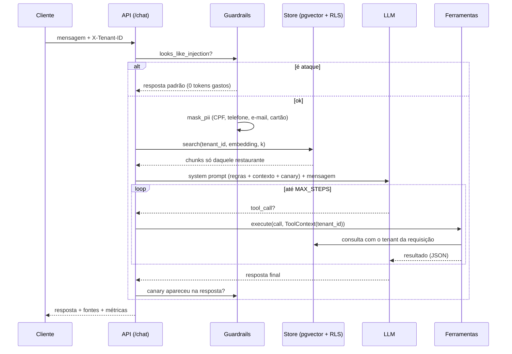

# Arquitetura

## Fluxo de uma mensagem

## Componentes

| Módulo | Responsabilidade |
|---|---|
| `agent.py` | Orquestra o fluxo acima e mede latência, tokens e custo |
| `store.py` | Interface `VectorStore` com duas implementações: `InMemoryStore` e `PgVectorStore` |
| `orders.py` | Repositório de pedidos, também com implementação em memória e em Postgres |
| `tools.py` | Especificação das ferramentas (JSON Schema) e execução com `ToolContext` |
| `guardrails.py` | Regras baratas que rodam antes e depois do LLM |
| `llm/` | Interface única `LLM.chat(system, messages, tools)` e adaptadores por provedor |
| `embeddings.py` | Interface `Embedder` com baseline por hashing e modelo semântico local |
| `ingest.py` | Lê os Markdown de cada restaurante, quebra por seção e indexa |
| `container.py` | Monta tudo a partir das variáveis de ambiente |

## Por que interfaces para tudo

Cada peça externa (LLM, embeddings, banco) tem uma interface e pelo menos duas implementações.
Isso permite:

1. **Testes e CI sem custo**: tudo roda offline com `FakeLLM`, `HashEmbedder` e `InMemoryStore`.
2. **Comparação justa**: o mesmo dataset de evals roda em qualquer combinação, então dá para medir
   quanto um modelo maior ou um embedding melhor realmente agrega.
3. **Troca de provedor sem mudar código**: só o `.env`.
